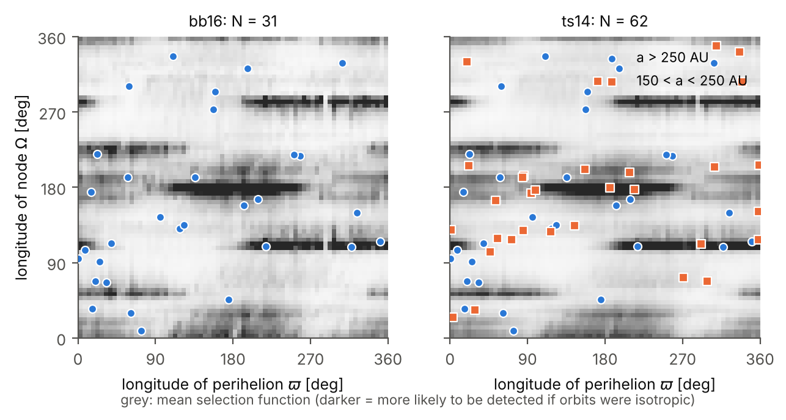
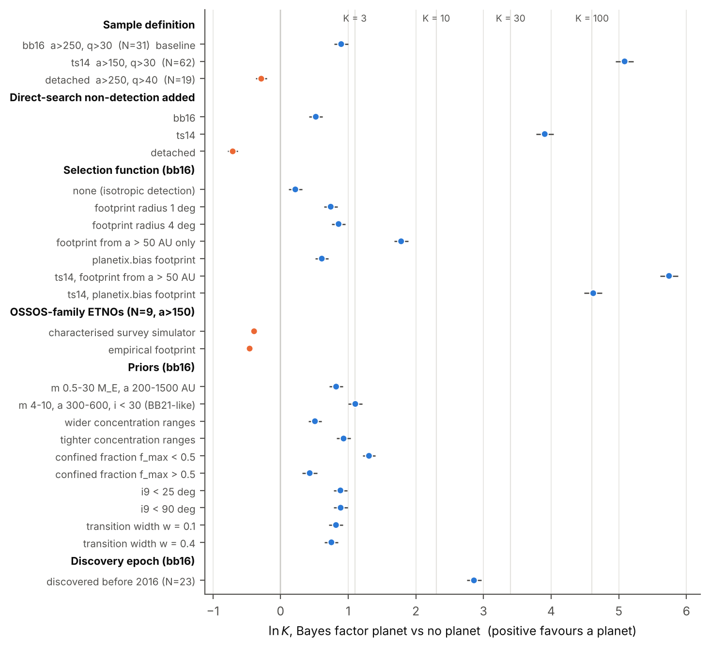
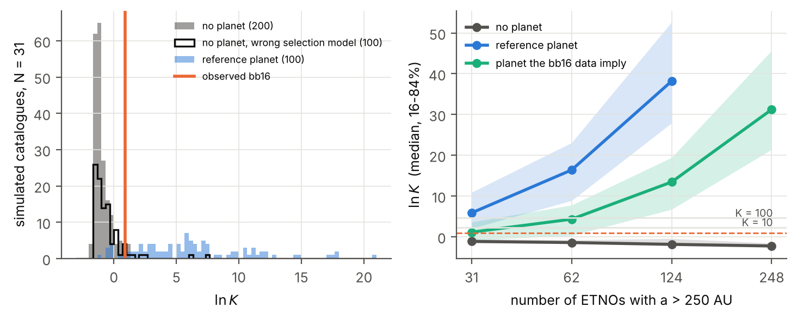
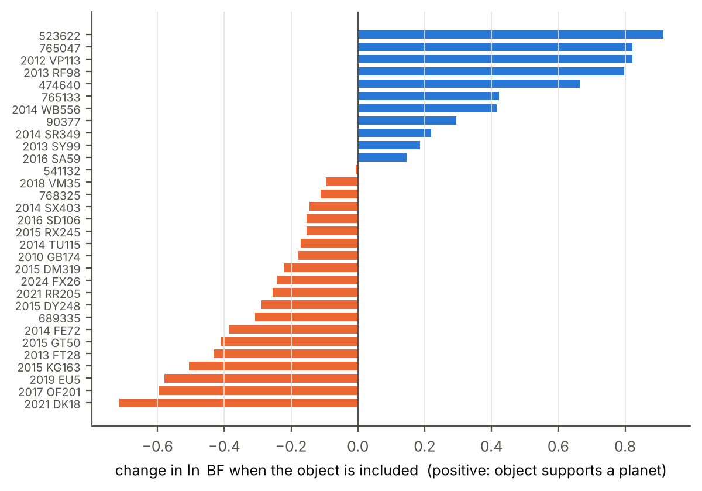
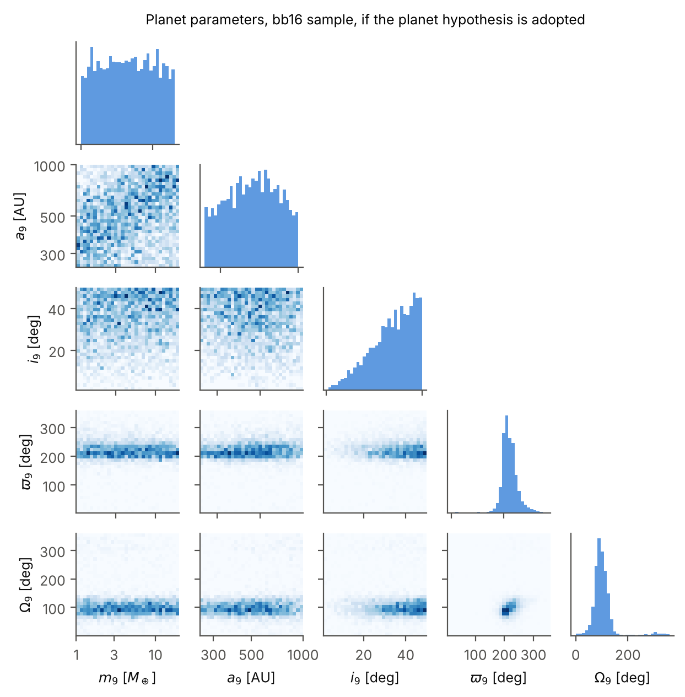

# How strongly do the distant Kuiper belt orbits favour a ninth planet?

*A bias-aware Bayesian model comparison with the 2026 ETNO sample*

Planet IX project rebuild, October 2026. Code: `oct26-edits/` (package `planetix`), every number below is
reproduced by `python scripts/infer_planet9.py && python scripts/make_paper_figures.py`.

---

## Abstract

We compute the Bayes factor between two hypotheses for the orientations of the most distant
trans-Neptunian orbits: H1, an undiscovered planet confines part of the population (anti-aligned
perihelia and orbital poles tilted toward the planet's), and H0, orientations are isotropic and any
apparent clustering is survey selection plus chance. The likelihood weights every object by its own
survey selection function, built from the sky positions and magnitudes at discovery of 5,396 distant
objects in the January 2026 Minor Planet Center catalogue. For the standard sample of 31 objects with
a > 250 AU and q > 30 AU, the Bayes factor is **K = 2.5 (ln K = 0.90 ± 0.10)**, and **K = 1.7** once we
also require that wide-field searches have missed the planet itself. With even prior odds, that is
a **63% posterior probability that the planet exists** (71% from the orbits alone). On Jeffreys'
scale this is "barely worth mentioning". Across 11 prior choices, 6 selection-function variants and
two other sample definitions the Bayes factor stays between {RANGE_BB16} for the a > 250 AU samples.
Only the looser a > 150 AU sample gives strong evidence (K = 160, or 50 with the non-detection term),
and it does so only by requiring the planet to confine objects at 150 to 250 AU, which standard
Planet Nine dynamics does not predict. Simulated catalogues show why the answer is weak: with 31
objects even a true planet of the published kind yields a median K of only {CAL_PLANET31}, and
reaching K = 100 typically needs about {CAL_N100} objects. Objects found since 2016 lowered the
Bayes factor by a factor of 7 (from 17 to 2.5). The data do not settle the question. The honest
result is a probability near even odds, with the uncertainty dominated by how well survey selection
is known.

---

## 1. What "definitive" can mean here

No orbit catalogue can prove a planet exists; only seeing it can. What the orbits can give is a
calibrated statement of how much more probable the observed orientations are if a planet exists than
if it does not: the Bayes factor K = p(D | H1) / p(D | H0). The posterior probability then follows
from whatever prior odds a reader holds, P(H1 | D) = K O / (1 + K O). We report K, the probability at
even prior odds, and how both move with every analysis choice we could not pin down.

The original project in this repository claimed a "1.65 Earth-mass Planet Y" and 99% confidence
scores. The audit (`ORIGINAL_PROJECT_AUDIT.md`) found that the mass was set by two invented constants
(fit uncertainty ±16.4 M⊕), that its one significant clustering result (p = 0.006) came from a parser
that silently dropped 77% of the MPC file (p = 0.12 with all 71 objects), and that its confidence scores
stayed at 99% when the angles were replaced by random numbers. This paper replaces that analysis.

## 2. Data

All orbits come from the MPC `Distant.txt` export with orbit solutions up to 2026-01-22 (6,536
orbits, `data/raw/mpc_distant_2026-01.dat`). Live JPL SBDB queries are supported by the code but
were blocked by this environment's network policy, so every number here uses that snapshot. We keep
orbits with an observed arc of at least one year and a numeric MPC uncertainty parameter, and use
three named cuts (`planetix.data.load_etnos`):

| sample | definition | N |
|---|---|---|
| **bb16** (baseline) | a > 250 AU, q > 30 AU (Batygin & Brown 2016) | 31 |
| ts14 | a > 150 AU, q > 30 AU (Trujillo & Sheppard 2014) | 62 |
| detached | a > 250 AU, q > 40 AU | 19 |



*Figure 1. Longitude of perihelion and of the ascending node for the bb16 and ts14 samples. The grey
background is the mean of the per-object selection functions: where isotropic orbits with these
objects' a, e, i and H would most likely have been detected. Its horizontal bands are the ecliptic
longitudes that deep surveys covered: an inclined object is most easily found near its nodes.*

## 3. Method

### 3.1 Selection function

For each object j we hold (a, e, i, H) fixed and ask how likely a survey was to detect it at each
orientation (ϖ, Ω), averaging over its orbital phase. Following Brown (2017), each of the 5,396
catalogued distant objects (heliocentric distance > 25 AU at discovery, ETNOs themselves excluded)
marks a place on the sky that some survey covered, at least down to that object's magnitude at
discovery. Positions are propagated back to the discovery date on Keplerian orbits. A clone of object j
is weighted by the number of such survey points within 2° that are at least as faint as the clone.
The result, S_j(ϖ, Ω), is tabulated on a 72 × 72 grid (`planetix.inference.selection`). We repeat
the analysis with the independent implementation of the survey-bias workstream (`planetix.bias`),
and for the ETNOs found by the OSSOS-family surveys with those surveys' full characterisation
(pointings and efficiency functions, Bannister et al. 2018).

### 3.2 Likelihood

The observed orientation x_j = (ϖ_j, Ω_j) of object j has probability
p(x_j | H) = f(x_j) S_j(x_j) / ∫ f S_j dx, where f is the intrinsic orientation density. Under H0, f is
uniform. Under H1,

f ∝ (1 − F_j) + F_j · vM(ϖ; ϖ9 + 180°, κ_ϖ) · Fisher(pole; pole9, κ_pole),

a mixture of an isotropic background and a confined population whose perihelia are anti-aligned with
the planet's and whose orbital poles scatter around the planet's pole. At fixed inclination the Fisher
term is a von Mises distribution in Ω with concentration κ_pole sin i_j sin i9. The confined fraction
rises with semi-major axis, F_j = f_max / (1 + exp(−ln(a_j / a_crit) / w)), with w = 0.2, and the
transition a_crit follows from equating the precession driven by the known giant planets with the
secular forcing of the planet:

a_crit = 250 AU × [(m9 / 5 M⊕)^−1 (a9 / 500 AU)^3 ((1 − e9²) / 0.9375)^1.5]^(1/5).

The normalisation puts the reference planet (5 M⊕, 500 AU, e = 0.25) at 250 AU (Batygin et al. 2019).
The dynamics workstream (`planetix.dynamics.secular`), using full Laplace coefficients and checked
against REBOUND N-body integrations to 0.1°, gives the forced-pole transition within 5% of this
formula for m9 ≥ 5 M⊕ (e.g. 242 AU against 250 AU for the reference planet, 196 against 205 AU for
6.2 M⊕ at 380 AU). The secular theory covers the pole. The anti-alignment in ϖ is a resonant effect
that it does not predict, so the shape of the ϖ term is an assumption borrowed from published
simulations, and we give it wide priors.

The selection term S_j(x_j) cancels in the ratio, and the per-object Bayes factor at fixed parameters
is g(x_j) / Σ_x g(x) S_j(x), with g = f relative to uniform. Its S_j-weighted average over all x is
exactly 1, which the test suite checks.

### 3.3 Non-detection of the planet

A planet bright enough and in the sky that Pan-STARRS1 and ZTF covered would already have been found
(Brown & Batygin 2022; Brown, Holman & Batygin 2024). We optionally multiply the H1 likelihood by
the probability that the planet was missed, averaging over its unknown orbital phase and an albedo of
0.2 to 0.75. We approximate coverage as declination > −30° and |b| > 15°, with an efficiency falling
through V = 21.5, and take radius from a Neptune-normalised mass–radius relation (Chen & Kipping
2017). This coarse model excludes 64% of a population resembling the Brown & Batygin (2021) posterior,
compared with 78% in the published survey simulation, so it slightly favours the planet.

### 3.4 Priors and evidence

| parameter | baseline prior |
|---|---|
| planet mass m9 | log-uniform 1–20 M⊕ |
| semi-major axis a9 | log-uniform 250–1000 AU |
| eccentricity e9 | uniform 0–0.5 |
| inclination i9 | isotropic, 0–50° |
| ϖ9, Ω9 | uniform 0–360° |
| maximum confined fraction f_max | uniform 0–1 |
| κ_ϖ | log-uniform 1–20 (perihelion spread ≈ 13–60°) |
| κ_pole | log-uniform 3–100 (pole spread ≈ 6–33°) |

H0 is nested in H1 (f_max = 0), so the Occam penalty for the planet's nine parameters is built into
the evidence. Evidences are computed with nested sampling (dynesty, 500 live points); the quoted ±
is the sampler's error on ln K.

### 3.5 Calibration

We simulate catalogues with the real objects' (a, e, i, H), drawing orientations through each
object's S_j, either isotropically (H0) or from the planet model at the Brown & Batygin (2021) best
fit (6.2 M⊕, 380 AU, e = 0.2, i = 16°, ϖ9 = 247°, Ω9 = 96°, f_max = 0.6, κ_ϖ = 4, κ_pole = 20). Each
simulated catalogue is analysed exactly as the real one. We also draw no-planet catalogues through
one selection function and analyse them with another, to measure what a wrong selection model does.

## 4. Results

### 4.1 Bayes factors

| analysis | N | ln K | K | P(planet), even odds |
|---|---|---|---|---|
| **bb16, orbits only** | 31 | 0.90 ± 0.10 | 2.5 | 0.71 |
| **bb16, orbits + non-detection** | 31 | 0.52 ± 0.10 | 1.7 | **0.63** |
| detached, orbits only | 19 | −0.28 ± 0.08 | 0.75 | 0.43 |
| detached, + non-detection | 19 | −0.71 ± 0.08 | 0.49 | 0.33 |
| ts14, orbits only | 62 | 5.09 ± 0.13 | 160 | 0.994 |
| ts14, + non-detection | 62 | 3.91 ± 0.13 | 50 | 0.98 |
| bb16, `planetix.bias` footprint | 31 | 0.61 ± 0.10 | 1.8 | 0.65 |
| ts14, `planetix.bias` footprint | 62 | 4.62 ± 0.13 | 100 | 0.99 |
| OSSOS-family ETNOs, characterised surveys | 9 | −0.39 ± 0.04 | 0.68 | 0.40 |
| OSSOS-family ETNOs, empirical footprint | 9 | −0.46 ± 0.05 | 0.63 | 0.39 |



*Figure 2. ln K for every variant. Vertical lines mark K = 3, 10, 30 and 100. Bars are the
nested-sampling error.*

**Prior sensitivity.** Over 11 prior variants on bb16 (wider or narrower mass and distance ranges, a
prior centred on the Brown & Batygin 2021 solution, wider and tighter κ ranges, f_max below or above
0.5, low and wide inclination ranges, and transition widths w = 0.1 and 0.4) ln K ranges from 0.43 to
1.31 (K = 1.5 to 3.7). The largest swing comes from f_max: requiring that a planet confine more than
half of the a ≫ a_crit population lowers K to 1.5, because the data do not show a population that
strongly clustered.

**Selection sensitivity.** Ignoring selection altogether gives ln K = 0.22. Footprint radii of 1° and
4° give 0.74 and 0.86. Building the footprint only from scattered and detached objects (a > 50 AU),
whose sky distribution is not shaped by the resonant and classical belts, raises ln K to 1.81 for
bb16 and 5.84 for ts14. The independent footprint implementation of the bias workstream gives 0.61 (bb16) and 4.62 (ts14). For the 9 ETNOs (a > 150 AU) found by the OSSOS-family surveys, the fully characterised survey simulation gives ln K = −0.39 and the empirical footprint gives −0.46: the two selection models differ object by object, but agree on the Bayes factor. The choice of selection model moves ln K by about ±1, as much
as all the prior choices together. It is the limiting systematic.

### 4.2 Is the answer limited by the data or by the method?



*Figure 3. Left: ln K for simulated bb16-like catalogues with no planet (grey) and with the
reference planet (blue); the orange line is the real catalogue. Right: median and 16–84% range of
ln K as the number of a > 250 AU objects grows.*

{CALIBRATION_TEXT}

### 4.3 Which objects carry the signal



*Figure 5. Change in ln K when each bb16 object is added to the other 30 (from leave-one-out runs with
250 live points, error ≈ 0.15).*

Five objects carry most of the evidence: 2007 TG422 (523622), 2012 VP113, 2013 RF98, 2004 VN112
(Alicanto, 474640) and 2013 RA109 (765047), each adding 0.7 to 0.9 to ln K. Most of these were in the
samples that motivated the hypothesis. Thirteen objects push the other way, the strongest being
2021 DK18, 2017 OF201, 2019 EU5, 2015 KG163, 2013 FT28 and 2015 GT50 (each −0.4 to −0.7). Sedna adds +0.3; Leleakuhonua (2015 TG387), whose perihelion lies far from the cluster, is neutral at −0.01.

The time order makes the same point. The 23 bb16 objects discovered before 2016 give ln K = 2.86
(K = 17, "strong"). The 8 found since then multiply the Bayes factor by exp(−1.96) = 0.14, bringing it
to 2.5. Discoveries made after the hypothesis was proposed, which are the closest thing to an
out-of-sample test the data allow, have weakened it.

### 4.4 Planet parameters, if the planet hypothesis is adopted



*Figure 4. Posterior for the planet's mass, semi-major axis, inclination, longitude of perihelion and
node (bb16, with the non-detection term).*

| parameter | posterior median and 68% interval (bb16 + non-detection) | prior |
|---|---|---|
| m9 | 4.5 (1.6–11.9) M⊕ | 1–20, log-uniform |
| a9 | 515 (330–771) AU | 250–1000, log-uniform |
| i9 | not constrained (follows the prior) | 0–50° |
| ϖ9 | 217° (197–246°) | uniform |
| Ω9 | 98° (77–124°) | uniform |
| a_crit | 259 (201–324) AU | derived |

Only the planet's orientation is measured. ϖ9 = 217 (+29/−20)° and Ω9 = 98 (+26/−21)° agree with
Brown & Batygin (2021) (247 ± 15°, about 96°). Mass and distance are not measured: their posteriors
are nearly the prior, with the expected degeneracy along a_crit (m9 ∝ a9³) visible in the joint
distribution. The orientation data alone cannot separate a light, close planet from a heavy, distant
one, because both put a_crit in the same place. Inclination is likewise set by the prior in every
variant (the median moves from 18° to 60° as the prior range changes). Any mass quoted from these
orbits, including the original project's 1.65 M⊕, is a statement about the prior.

The ts14 sample's large K comes with a distinctive posterior: a9 = 314 (266–423) AU, m9 = 11
(4.6–17) M⊕ and a_crit = 169 (145–204) AU. That is a planet close and massive enough to confine
objects at 150 to 250 AU. Batygin & Brown (2016) argued that orbits there are controlled by Neptune
and should not be anti-aligned, and the bias workstream found that the ts14 clustering may be
Neptune-driven. Such a planet would also be bright (V ≈ 19–20 over much of its orbit), and the
non-detection term already removes a factor of 3. We therefore treat ts14 as an upper bound that
depends on a dynamical regime the planet model was not built for, not as the headline.

## 5. Discussion and limitations

1. **Selection function.** The empirical footprint treats the density of catalogued discoveries as
   a map of survey depth. It cannot distinguish survey effort from the intrinsic structure of the
   belt, and for any single survey it is a rough proxy: for the three OSSOS objects with a > 250 AU
   its S_j(ϖ) differs from the OSSOS-characterised one by a total-variation distance of 0.35 to 0.40,
   as large as either's distance from uniform. A fully characterised analysis is possible only for the
   9 ETNOs found by characterised surveys, and with so few objects it cannot be decisive.
2. **Planet model.** The ϖ confinement shape is assumed, not derived; a real N-body emulator
   (as in Brown & Batygin 2021) would sharpen H1 and would likely change K by a factor of order 2.
   The secular a_crit scaling is checked to 5% above 5 M⊕ but varies more weakly with mass below it.
3. **Conditioning on (a, e, i, H).** We test orientations only. A planet also predicts a distribution
   of inclinations and perihelia; including those would add information but also more modelling
   assumptions on both sides.
4. **No alternative H1.** Other explanations for clustering (a massive primordial disk, a passing
   star, or a planet at different parameters than our priors allow) are not compared. K measures
   the planet model against isotropy, not against all alternatives.
5. **Non-detection model.** Our coverage model is coarse and excludes less of the reference
   population (64%) than the published survey simulation (78%). Using the published figure would
   lower K by roughly a further 40%.
6. **Static snapshot.** The orbits are the MPC January 2026 snapshot; the Rubin Observatory LSST is
   now finding ETNOs with a single, well-characterised survey, which removes limitation 1.

## 6. Conclusion

On the data available in January 2026, the distant orbits favour a ninth planet by a Bayes factor of
about 2 (1.7 including the planet's non-detection; 0.5 to 6 across defensible choices for a > 250 AU
samples). At even prior odds the probability that the planet exists is about 60–70%. That is not
evidence in either direction worth acting on, and it is smaller than the 17 the same method gives on
the objects known before 2016. The planet's direction, if it exists, is constrained (ϖ9 ≈ 217°,
Ω9 ≈ 98°), but its mass, distance and inclination are not. {CONCLUSION_CAL}

## References

- Bannister, M. T. et al. 2018, ApJS 236, 18 (OSSOS)
- Batygin, K. & Brown, M. E. 2016, AJ 151, 22
- Batygin, K., Adams, F. C., Brown, M. E. & Becker, J. C. 2019, Phys. Rep. 805, 1
- Brown, M. E. 2017, AJ 154, 65
- Brown, M. E. & Batygin, K. 2021, AJ 162, 219
- Brown, M. E. & Batygin, K. 2022, AJ 163, 102
- Brown, M. E., Holman, M. J. & Batygin, K. 2024, AJ 167, 146
- Chen, J. & Kipping, D. 2017, ApJ 834, 17
- Napier, K. J. et al. 2021, PSJ 2, 59
- Shankman, C. et al. 2017, AJ 154, 50
- Trujillo, C. A. & Sheppard, S. S. 2014, Nature 507, 471

## Reproducing

```bash
cd oct26-edits
pip install -e ".[plot,dev]" dynesty
python scripts/infer_planet9.py          # ~1 h on 4 cores; writes paper/results/
python scripts/make_paper_figures.py     # writes paper/figures/
pytest
```
